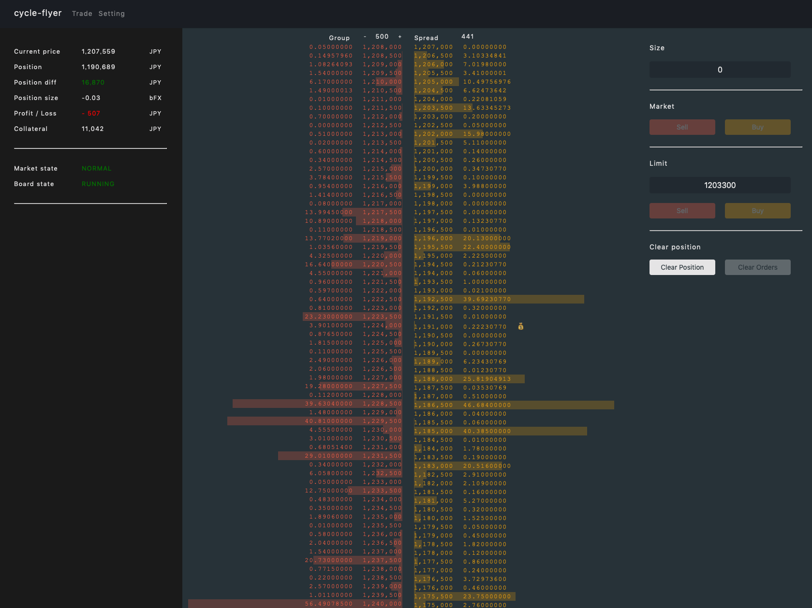

# cycle-flyer

## Download

Download the latest release from [GitHub Releases](https://github.com/bitflyer-tools/cycle-flyer/releases).

## Quick start

1. Download the installer or archive for your platform from [GitHub Releases](https://github.com/bitflyer-tools/cycle-flyer/releases/latest).
2. Follow the instructions for your platform.
   - **Windows** — Run the Setup executable.
   - **macOS (Apple Silicon, `arm64`)** — Extract the ZIP.
   - **Linux (x86-64)** — Install the `.deb` (`amd64`) or `.rpm` (`x86_64`) package for your distribution.
3. Open Cycle Flyer. On the **Trade** screen, check the bid and ask prices and the spread in the order book. Use **−** and **+** next to **Group** to adjust the price grouping.

You can view the order book without an API key.

## Author

[@unhappychoice](https://unhappychoice.com)

## Tests

Use Node.js 24. Run `npm ci` to install dependencies and `npm test` to run the full suite.
